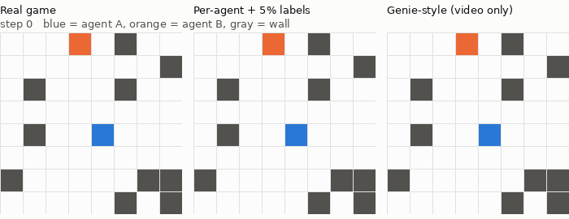
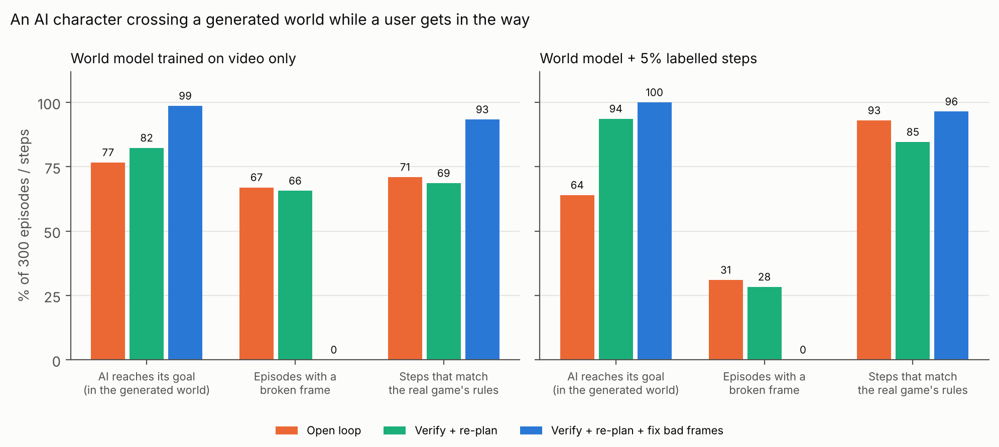
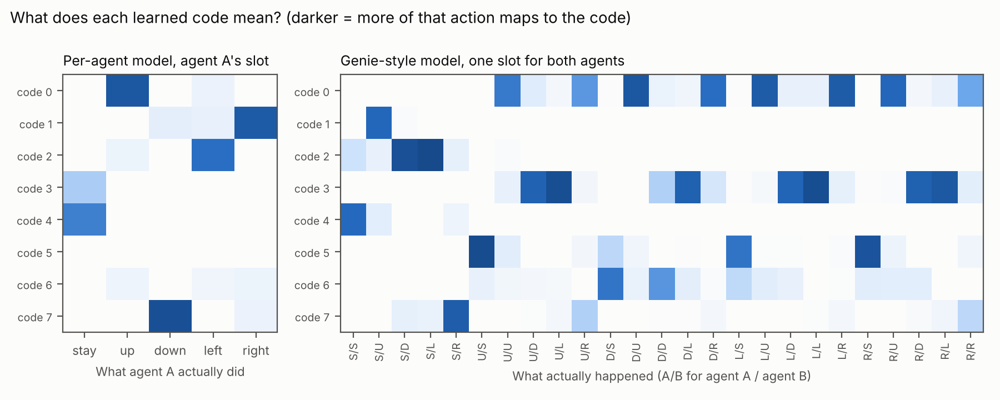
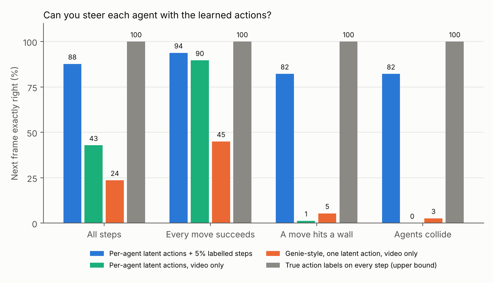
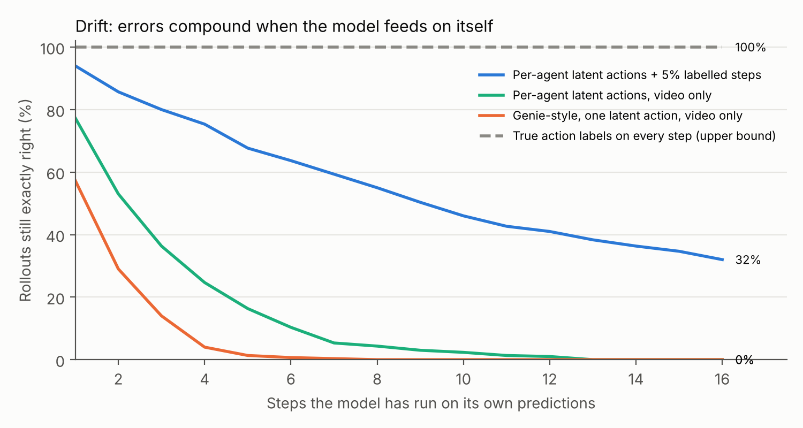

# Two agents, one world: what breaks when AI characters share a generated environment?

*November 4, 2026 · @Varun Atraya · World models / multi-agent RL*

I started reading about Project Genie recently, and the bit that caught my attention was the challenge of having multiple agents act in the same generated world. It's close to the multi-agent RL work I've been doing, except I'm usually looking at what an agent can learn about another agent. I wanted to try looking at it from the world's side instead.

I built a little 8×8 gridworld with two characters and trained a model to predict what happens when they move. Then I gave one of them a goal to reach while the other wandered around and sometimes got in the way.

The funny thing was that the AI could sometimes reach its goal by **walking straight through a wall**. The goal counter said it had succeeded, but the world was clearly getting things wrong. I ended up testing some basic ways to catch those mistakes and fix them without going back and retraining the whole model.

*Just a sample rollout of the gridworld, not the wall failure.*

I'll start with what happened when I let an AI character navigate the generated world, then get into how the model was trained. This is a tiny grid experiment, not actual Genie or a user study.

## Part 1: When the learned world breaks

I gave agent B a goal on the grid and had it plan a route there. Agent A wandered around and sometimes stepped into its path. I treated A as the user-controlled character, although for these tests its movements came from a script, not a person. After each move, the model predicted what the grid should look like next.

The important part is that I used the learned model as the world. There wasn't a game engine correcting its predictions behind the scenes. If the model put someone on the other side of a wall, that's what the AI saw on its next step.

I tested three ways to run it over **300 episodes**:

| Runtime setup | What happens |
|---|---|
| Open loop | Take the model's next state and keep going |
| Check + replan | Flag an impossible state or failed step and plan again, but don't replace the generated state |
| Check + recover | Reject invalid generated candidates, pick a candidate that passes the checks, and replan when needed |

I wrote a basic rule checker for the grid: no walking through walls, teleporting, overlapping, or swapping places. It also checks whether the requested movement actually happened.

Google describes Gemini checking progress in Genie 4 and adapting its plan as things happen. That's part of what I was curious about. My checker is just a hand-written gridworld version of the idea, though, not Gemini or Google's actual implementation.

### A 77% success rate that was actually bad news

In the open-loop experiment, the video-only model's AI reached its goal in **77%** of episodes. That was higher than the **64%** goal-reaching rate reported for the better-trained comparison model.

But **67% of all the open-loop episodes** had at least one impossible state. The AI was sometimes getting there by walking through a wall or another character.

That result made me laugh a bit. I'd built something that could report a win partly because the world let the AI cheat.

*Replanning changes the route, but it doesn't stop the model from producing impossible states. Recovery actually changes which state gets accepted.*

A better metric would be how often the AI reaches the goal **without any broken steps along the way**. I added that check to the evaluation script, but I haven't rerun the experiment yet, so I'm not claiming a number for it.

### A checker that only complains doesn't solve much

My first attempt was to check each frame and make the AI replan when something looked wrong. That barely helped: episodes with a broken frame went from about **67%** to **66%**.

It made sense once I looked at what I was actually changing. The AI was picking a new route, but I was still accepting the same bad predictions from the world model.

So I changed the decoder to reject invalid positions and pick the most likely valid alternative from the scores it had already computed. I didn't run the world model again; I just used its existing prediction differently.

With that change, accepted checker violations dropped to **0%**, and agreement with the actual gridworld's transition rules improved from **69% to 93%** in the reported evaluation.

Zero accepted violations sounds impressive, but it mostly follows from the way I wrote the checker: it won't accept a frame that breaks its own rules. The more useful result is **93% agreement with the separate gridworld simulator**. A frame can pass the checks and still be wrong.

### What would recovery cost in a real-time world?

With the video-only model, recovery stepped in on about **25%** of frames. After fine-tuning with 5% labeled data, it only needed to step in on about **8%**.

| Model during recovery | Frames that needed correction |
| --- | ---: |
| Video-only | About 25% |
| Fine-tuned with 5% labeled transitions | About 8% |

*This is the share of generated steps that needed a correction, not a measured latency penalty.*

My version was cheap because the correction reused the model's existing scores. With actual generated video, that might be a lot harder. If every correction means generating more frames, fixing the world could also make it feel slower to control.

I haven't measured meaningful end-to-end latency, so **25% corrected frames isn't a latency estimate**. The next thing I'd measure is how many attempts each accepted frame takes and how long it takes for an action to show up on screen.

## Part 2: Why the model struggled with blocked moves

This is where the first half of the project comes in. Before trying the AI-goal experiment, I'd trained models to infer what the two agents were doing just from changes in the grid.

### Why learn actions from video?

The [original Genie paper](https://proceedings.mlr.press/v235/bruce24a.html) starts with a problem I hadn't thought much about before. If you train on gameplay videos from the internet, you see what happened on the screen, but you don't know which buttons the player pressed. Genie handles this with a latent action model that learns a small set of codes to help predict the next frame. Ideally, those codes pick up something like the player's actions without being given the action labels.

If there's only one player, it's easy to imagine a code learning something like "move left." With two players moving at once, though, what should one code mean? A moves left? B moves right? Both do something?

So my first test was pretty simple: what changes if each agent gets its own latent action instead of sharing one code for the entire step?

### The setup

The world is an 8×8 grid with random walls and two agents. Each agent chooses **stay, up, down, left, or right** on every step. They move simultaneously, except that moves fail if an agent hits a wall, two agents try to occupy the same square, or they try to swap places.

I generated **48,000 transitions** from **3,000 episodes of 16 steps**. Their movements were mostly random, although I made them chase each other sometimes so they would actually collide. I trained four versions:

| Model | What it sees during training | Action representation |
|---|---|---|
| Joint 8-code | State transitions, no action labels | One code for both agents |
| Per-agent | State transitions, no action labels | A separate code for each agent, using a shared 8-code vocabulary |
| Per-agent + 5% labels | Same pretraining, then 2,400 labeled steps for dynamics fine-tuning | Two agent-specific codes |
| Fully supervised baseline | True actions throughout training | Ground-truth actions |

I skipped the video tokenizer because the observations are already tiny grids. The learned model predicts the next grid state directly. So this is inspired by Genie's *latent-action question*, not an implementation of Genie 1 or Genie 4.

There's a catch in that comparison, though. The joint model has eight codes, while the per-agent model has two slots of eight, meaning up to 64 combinations for 25 possible pairs of actions. So some of the improvement might just be extra capacity. I still need to try a larger joint codebook before attributing the difference to separating the agents.

### First result: two code slots made independent steering easier

The one-code model struggled to give each code a clear meaning. Its codes ended up mixing different pairs of actions, and the most common action pair only accounted for around **52%** of a code's uses.

The per-agent codes were easier to interpret. They matched an individual action about **92%** of the time, and in 2,000 sampled states, changing A's code while B was told to stay didn't move B.

*The per-agent codes were easier to interpret in this run. The codebook sizes weren't a fair match, though.*

At first I thought that was most of the problem solved. Then I looked at collisions, and the results were much worse.

### The weird part: a blocked move looks exactly like doing nothing

When both moves succeeded, the per-agent model steered correctly around **90%** of the time, compared with **45%** for the joint eight-code baseline.

Then I separated out the cases where a move *couldn't* happen. The per-agent video-only model got roughly **1%** accuracy on wall hits and **0%** on agent collisions in that initial evaluation. It was especially bad when the characters got in each other's way.

It took me a bit to figure out why. Imagine an agent standing next to a wall. It tries to move into the wall, so it stays in the same square. Now imagine it chooses "stay" instead. The frames look exactly the same, even though the agent tried to do two different things.

That's the problem with only seeing the frames. You know where the agent ended up, but you don't necessarily know what it tried to do. There isn't enough information in that one transition to tell the two cases apart. Longer histories might give you clues, but a single blocked move is ambiguous.

With two characters, those blocked moves happen for more reasons than just hitting a wall.

### What changed with a little labeled data?

I kept the per-agent encoder and its codes fixed, then fine-tuned the dynamics on **2,400 labeled transitions**, just 5% of the original dataset.

In the initial run, accuracy on wall hits and collisions climbed to about **82%** for each, and overall steering accuracy reached **88%**. The fully supervised baseline reached 100% in this tiny setting.

The movement codes were already there. The extra examples helped teach the model what to do when someone *tries* to move and can't.

Rollouts made the gap more obvious. After eight steps feeding each prediction back into the model, **55%** of the fine-tuned rollouts were still exactly correct. The per-agent video-only model was at **4%**, and the joint eight-code model at **0%**. By step 16, the fine-tuned model was down to **32%**. Even the better model drifted; it just drifted much more slowly.

## What this does (and doesn't) say about Genie

[Google's Genie 4 announcement](https://deepmind.google/blog/genie-4-a-new-generation-of-world-simulation/) describes a system where Gemini observes the generated simulation, checks whether steps happened, and changes its plan when a user intervenes. Google also lists interactions between independent agents and maintaining a shared world as ongoing research problems.

I came away thinking about three separate things: whether I can control each character, whether the world follows its own rules, and whether the AI reaches its goal. My first results made it pretty clear those aren't interchangeable.

It's also a very different setup from Genie. My model predicts grid positions, not video or audio. I can check the exact wall and character locations, which you can't just read off from a generated video. I also used one main training seed, scripted behavior, and separate channels for the two characters.

So I wouldn't use any of these numbers to make claims about Genie. It was just a useful way to see how misleading a task-success metric can be when the environment itself is learned.

## What I'd test next

The first thing I'd do is train a **capacity-matched joint-action model**. My eight-code baseline is too small to separate whether per-agent factorization helps from whether it simply has more room to represent actions.

After that I'd rerun the experiments with multiple seeds and new wall layouts, and report **valid task success** alongside goal-reaching. I'd also log how often recovery intervenes and what it costs in runtime, rather than guessing about the latency tradeoff.

I'd also be interested in a learned checker. Writing rules for an 8×8 grid is easy enough; doing the same thing for arbitrary generated scenes is a completely different problem. A learned checker could help, but then you'd have to evaluate its mistakes too.

## What I took away

I started this because the two-agent problem reminded me of my research, but the bit I keep thinking about isn't really the action codes. It's how easily I could get a good-looking result while the world was doing something obviously wrong. Seeing that happen on a tiny grid made me want to be more careful about what counts as success.

## Code and reproducibility

The [code and figures are on GitHub](https://github.com/atrayav/Playing-with-project-genie-and-world-model-experimentation-). The experiment consists of the gridworld, latent-action models, rollout evaluation, and a second stage with verification, replanning, and recovery. Both parts were designed to run on a laptop CPU. The numbers above are from the initial reported runs; they haven't yet been replicated across multiple seeds, so please treat the precise percentages as provisional.

I used an AI coding assistant while implementing it. I chose the questions and experimental comparisons, debugged the behavior, and worked through what the results might mean. I'd want to reproduce the results independently before putting much weight on the precise percentages.

If you spot something I've missed, I'd love to hear about it.

---

**References:** [Genie: Generative Interactive Environments (ICML 2024)](https://proceedings.mlr.press/v235/bruce24a.html); [Google DeepMind's Genie 4 announcement (Oct 27, 2026)](https://deepmind.google/blog/genie-4-a-new-generation-of-world-simulation/); [Project Genie launch (Jan 29, 2026)](https://blog.google/innovation-and-ai/models-and-research/google-deepmind/project-genie/).