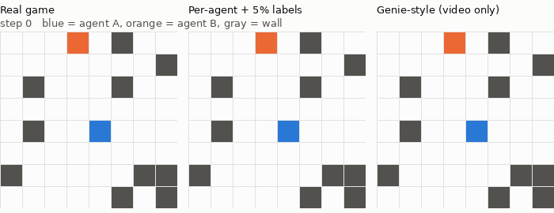
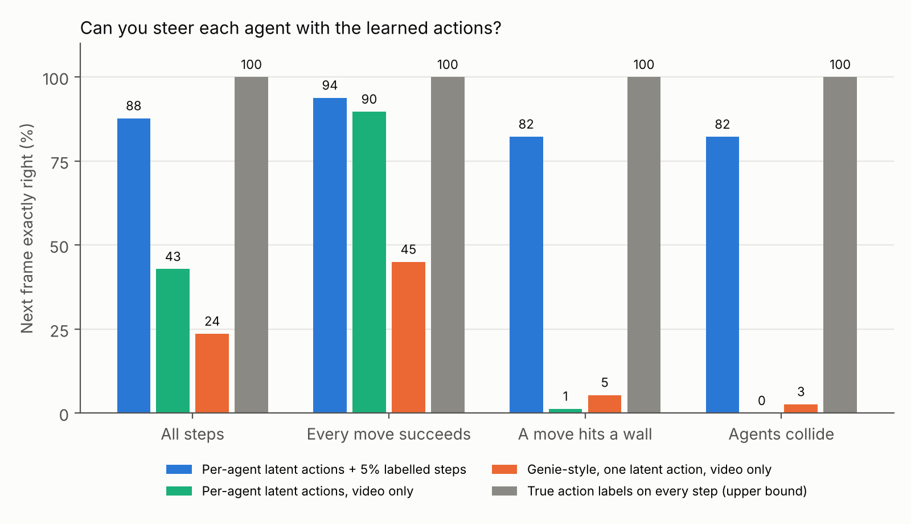
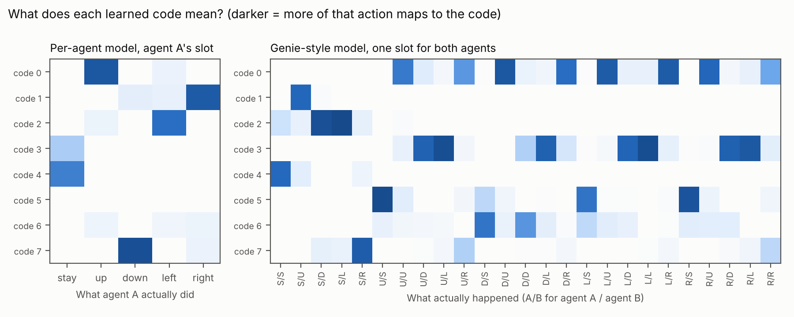
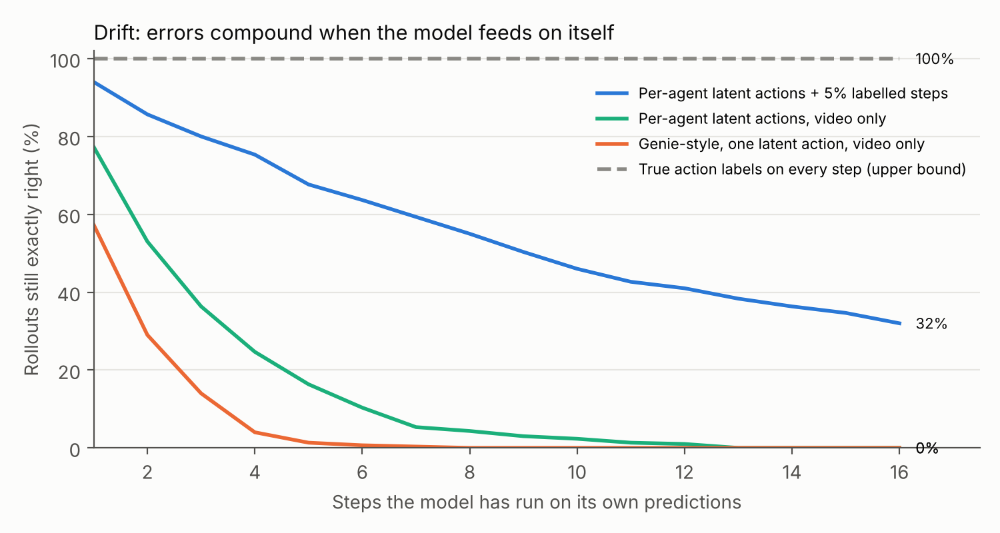
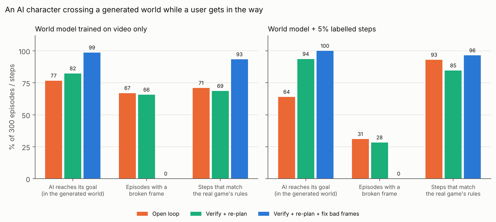

# mini-genie-multiagent

A small Genie-inspired experiment about what happens when two characters interact in a world generated by a model—and why reaching a goal doesn't mean much if the world breaks its own rules.

**[Read the experiment and see the figures](https://atrayav.github.io/Playing-with-project-genie-and-world-model-experimentation-/)**

Genie 1 learns a controllable world from unlabeled video. Its *latent action model* infers, for each pair of frames, which of 8 discrete "actions" explains the change. That works for one player. **What happens with two?** This repo trains Genie-style world models on a two-agent gridworld and asks whether you can steer each agent separately.



## The setup

- **World:** an 8×8 grid with random walls and two agents (A in blue, B in orange). Both move at once, with 5 actions each (stay, up, down, left, right). A move fails if it hits a wall, if both agents target the same cell, if they try to swap places, or if the target cell is occupied by an agent that's staying put. These collision rules are the *interaction* a multi-agent world model has to learn.
- **Data:** 3,000 episodes × 16 steps (48,000 transitions) from a random policy that sometimes chases the other agent. About 20% of steps involve an agent-agent collision. The test set is 400 separate episodes.
- **Simplification:** frames are tiny, so there's no video tokenizer. The latent action model's decoder doubles as the dynamics model.

| Model | Action labels used in training | Latent actions |
| --- | --- | --- |
| **Genie-style** | none | one code per transition, 8 codes (as in Genie 1) |
| **Per-agent** | none | one code *per agent*, shared 8-code codebook. Each slot's encoder sees only its own agent |
| **Per-agent + 5% labels** | 2,400 of 48,000 transitions | the per-agent model with only its dynamics fine-tuned on the labelled steps; encoder and codes frozen |
| **Oracle** | all | true actions (upper bound) |

To **play** a latent-action model, you need to know which code means "left". As in Genie, a small labelled calibration set (100 test episodes) maps each real action to its most common code. Labels are otherwise used only for scoring.

## Results (held-out episodes)



| Next frame exactly right | Genie-style | Per-agent | Per-agent + 5% labels | Oracle |
| --- | --- | --- | --- | --- |
| All steps | 24% | 43% | **88%** | 100% |
| Every requested move succeeds | 45% | 90% | **94%** | 100% |
| A move hits a wall | 5% | 1% | **82%** | 100% |
| Agents collide | 3% | 0% | **82%** | 100% |
| Rollout still exact after 8 steps | 0% | 4% | **55%** | 100% |
| Rollout still exact after 16 steps | 0% | 0% | **32%** | 100% |

Other checks:

- **Reconstruction:** given the codes the encoder infers from the real frame pair, the per-agent model reproduces the next frame 100% of the time; Genie-style manages 71%.
- **Code purity** (how often a code maps to one real action): Genie-style codes vs. joint actions 52%; per-agent slots 92–93%.
- **Leakage:** changing agent A's code while B's says "stay" moved B in 0% of 2,000 test states.




## What I learned

1. **Separating the two agents made steering easier in this first comparison.** Two agents with 5 actions each make 25 joint actions, while my joint baseline had only 8 codes. The joint codes became mixtures (right-hand heatmap); the per-agent slots gave 90% exact steering on unblocked moves versus 45%. But two 8-code slots allow up to 64 combinations, so the baseline isn't capacity-matched. I can't attribute all of the improvement to the factorization alone.
2. **Video alone teaches *what happened*, not *what each agent tried to do*.** A blocked move looks identical to "stay", so the video-only models never see "tried to move left and was stopped." When asked to move into a wall or into the other agent, they walk straight through (0–5% exact). This seems fundamental for multi-agent worlds, since collision outcomes depend on both agents' intentions, which video doesn't reveal.
3. **A little labelled interaction data goes a long way.** Fine-tuning only the dynamics on 5% labelled steps raised collision accuracy from 0% to 82% and kept 55% of rollouts exact after 8 steps (vs. 4%).
4. **Drift is the real metric.** One-step accuracy of 88% becomes 32% exact after 16 self-fed steps, because errors compound. That's the long-horizon consistency problem Genie 3 and 4 work on at vastly larger scale.
5. **Encoder design decides whether actions mean anything.** My first encoder flattened the grid, so it could see *where* an agent was; its codes meant "down here, left there" (purity 76%). I switched to convolutions with global max-pooling to reduce dependence on absolute position, which raised measured code purity to 92% in the initial experiment. That encourages—but doesn't guarantee—translation invariance.

## Part 2: closing the loop (an AI character, a user, and a generated world)

In Project Genie the learned model *is* the world; no game engine sits underneath. Genie 4 adds Gemini as a "guiding agent" that, in DeepMind's words, "reviews incoming frames to track the progress and verify that each step succeeded" and "adapts its plan in the moment" when the user intervenes. `closedloop.py` tests a toy version of that loop:

- **AI character (agent B):** told to reach a goal cell at least 5 steps away.
- **Simulated user (agent A):** follows a scripted policy, wandering and sometimes moving toward B. No humans were involved in this test.
- **World:** the learned model generates every frame. The real game rules are used only to score afterwards.
- **Verifier (hand-written rules):** no agent inside a wall, no moving more than one cell, no two agents in one cell, no swapping through each other, and each agent either did what it was told or stayed put. This stands in for what Gemini does in Genie 4; it is not learned.

| Configuration | What it does |
| --- | --- |
| Open loop | B plans a route once and follows it blindly; every generated frame is accepted |
| Verify + re-plan | Every frame is checked; B re-plans each step from what the world shows |
| Verify + re-plan + fix bad frames | When a frame fails, take the model's most likely frame that passes the checks (constrained re-decoding) |



| 300 episodes | Video-only: open loop | Video-only: re-plan | Video-only: fix frames | +5% labels: open loop | +5% labels: re-plan | +5% labels: fix frames |
| --- | --- | --- | --- | --- | --- | --- |
| AI reaches goal (in the generated world) | 77% | 82% | 99% | 64% | 94% | 100% |
| Episodes with a broken frame | 67% | 66% | 0% | 31% | 28% | 0% |
| Steps matching the real game's rules | 71% | 69% | 93% | 93% | 85% | 96% |
| Frames that had to be fixed | n/a | n/a | 25% | n/a | n/a | 8% |

What it shows:

1. **Task success in a broken world can be fake.** The video-only model's open-loop agent "reaches its goal" 77% of the time, more than the better model's 64%, because in its world the AI walks straight through the user and through walls. About 67% of all the open-loop episodes contain a frame that fails the verifier's rules. Task metrics need validity checks next to them.
2. **Detecting problems isn't enough; you have to act on them.** Re-planning alone barely changes the broken-frame rate. Rejecting bad frames and re-decoding removes them entirely, and steps matching the real rules jump from 69% to 93%.
3. **A runtime fix can match a data fix, at a cost.** Verification plus recovery on the video-only model (93% rule-consistent) matches the labelled model running open loop (93%). But it had to fix 25% of frames versus 8%. Here re-decoding is nearly free because it reuses the same prediction. In a real-time world model, a rejected frame might require additional work, but these percentages are not latency measurements. That tradeoff would need direct measurement. Better training data could reduce how often the system needs to intervene.
4. **Valid isn't the same as correct.** Even with every frame passing the checks, 4–7% of steps still differ from what the real game would do. Example: both agents moving when the rules say they'd block each other. A rule checker catches impossible frames, not merely wrong ones.

## Limitations

- An 8×8 grid world is nothing like real video. There are no pixels, appearance, lighting, or partial observability.
- The per-agent model is told which channel belongs to which agent. Real video would need object discovery or segmentation first.
- One seed per model; numbers would shift somewhat across seeds.
- The random policy isn't realistic agent behavior.
- Part 2's verifier knows the game's physics rules. Gemini in Genie 4 has to judge open-ended scenes with no rulebook, which is far harder.
- Part 2 timing isn't meaningful at this scale, so frames fixed is used as the cost proxy.

**Evaluation note:** `closedloop.py` now records `valid_goal_reached` (goal reached without a flagged invalid frame) for future runs. The existing `results_closedloop.json` predates that metric; no combined percentage is claimed yet.

## Run it

```bash
pip install -r requirements.txt
python train.py          # ~25 min on a laptop CPU; trains oracle, genie, peragent
python finetune.py       # ~3 min; per-agent + 5% labels
python evaluate.py       # writes results.json
python plots.py          # figures + rollout.gif
python closedloop.py     # ~1 min; part 2, writes results_closedloop.json
python plot_closedloop.py
```

Files: `env.py` (gridworld and collision rules), `model.py` (VQ, latent action encoder, dynamics), `train.py`, `finetune.py`, `evaluate.py`, `plots.py`, `closedloop.py` (planner, user, verifier, recovery), `plot_closedloop.py`.

Reference: Bruce et al., *Genie: Generative Interactive Environments*, ICML 2024 (arXiv:2402.15391).
